# High Innovation! Bearing Fault Diagnosis Model Based on FFT+WDCNN-Transformer Time-Frequency Domain Fusion

1. Introduction
This article is based on the bearing data from Case Western Reserve University (CWRU), which first undergoes data preprocessing to create and load the dataset, and finally classifies faulty data through the PyTorch implementation of the FFT+WDCNN-Transformer model. For a detailed introduction to the CWRU bearing data, please refer to the following:

2. Python-Case Western Reserve University (CWRU) Bearing Data Interpretation and Classification Process
1. Model Overview and Innovation Points
1.1 Model Overview
●Dataset: CWRU Case Western Reserve University Bearing Dataset
●Environmental Framework: python 3.9, pytorch 1.8 or above can run
●Accuracy: 100% on the test set
●Usage: Paper requirements, graduation design requirements
●Code Guarantee: Code comments are detailed and ready to run without modification.
1.2 Innovation Points
Bearing Fault Diagnosis Innovative Model Based on FFT+WDCNN-Transformer:
1. Principle Process:
 (1)Raw Signal Input: Input the bearing vibration signal (time domain signal) as the initial data for the model.
 (2)Two independent branches extract time-frequency features respectively:
   - Time domain branch: directly input the raw time domain signal into the WDCNN-Transformer serial model structure;
   - Through WDCNN (Variable Width Convolutional Neural Network), extract local temporal features in the time domain;
   - Through Transformer module capture long-distance global dependencies and context information;
   - Finally obtain the representation of time-domain features.
   - Frequency domain branch: perform Fast Fourier Transform (FFT) on the original signal to obtain frequency-domain feature representation;
   - Input the frequency-domain signal into the WDCNN-Transformer serial model structure;
Similar to the time-domain branch, first extract local frequency domain features by WDCNN, then capture global dependencies in the frequency domain by Transformer;
Finally, obtain frequency domain feature representations.
(3) Time-frequency domain feature fusion: Add weighted matrix addition of the features from both time-domain and frequency-domain branches to achieve integration of time-frequency information;
The fused features contain both temporal dynamic information and frequency component information.
(4) Fault classification: Use the fused feature matrix as input, and classify bearing fault categories through a classifier (such as fully connected layers and Softmax).
2. Innovation points:
(1) Dual branch parallel feature extraction in time-frequency domain:
Traditional fault diagnosis uses only time domain or frequency domain manual features, or single-path deep networks.
This model simultaneously utilizes both time and frequency domains, and respectively use deep networks to automatically extract features to ensure comprehensive mining of signal information from multiple angles.
(2) WDCNN-Transformer serial structure:
WDCNN with variable width design is suitable for multi-scale feature extraction, enhancing the expressiveness of time-frequency features;
Transformer introduces self-attention mechanism to effectively capture long-distance dependencies, improving the model's ability to model complex signals;
By connecting CNN and Transformer, the efficiency of utilizing time-series and spatial features is enhanced.
(3) Time-frequency domain feature fusion:
Using weighted addition of feature matrices to avoid simple concatenation leading to dimension explosion issues;
Feature fusion fully combines the complementary advantages of time and frequency information, enhancing the discriminability of fault features.
The model can directly receive raw signals and their spectrum signals without complex manual feature engineering;
End-to-end training improves the model's scalability and generalization capability.
2. Bearing data loading and preprocessing:
2.1 Import data
References to previous articles for preprocessing of fault classification, Case Western Reserve University bearing data 10-class dataset:
Train set, Val set, Test set are divided according to 7:2:1 ratio for training set, validation set, and test set, respectively, and the data is finally saved.
2.2 Fault FFT transformation visualization
2.3 Preprocessing of fault data
3. Innovative Diagnosis Model Based on FFT+WDCNN-Transformer
3.1 Definition of FFT+WDCNN-Transformer network model
3.2 Setting parameters and training the model
50 epochs, accuracy 100%, the FFT+WDCNN-Transformer network has a significant classification effect, the model can fully extract multi-scale features of bearing fault signals, converges quickly, with exceptional performance, and the effect is noticeable.
3.3 Model evaluation
(1) Accuracy, Precision, Recall, F1 Score
(2) Fault very class confusion matrix:
(3) Classification label visualization
(4) Original data t-SNE feature visualization
(5) T-SNE feature visualization after model training:
Click to download: Complete original data, Python code
Previously interesting content:
Python Bearing Fault Diagnosis | From Beginner to Publication
Python Bearing Fault Diagnosis (14) Highly innovative fault recognition model
 | Sci-fi 1st-class high innovation bearing fault diagnosis model!
Attention modification | Super strong bearing fault diagnosis model!
Based on K-NN + GCN bearing fault diagnosis model
27 bearing fault diagnosis models | The most cost-effective whole set in the internet
 | Based on KAN, KAN convolution bearing fault diagnosis model
Time-frequency graph update | Bearing fault diagnosis based on visual top conference + time-frequency graph
Fault Diagnosis | Code Explanation + Live Classes, currently in progress!
Rapid Document | Parallel Fault Diagnosis Model Based on 2D-SWinTransformer+1D-CNN-SENet
Positional Decoding | Detailed Explanation of Positional Encoding in Transformer
Resource Sharing | Intelligent Fault Diagnosis and Prediction Based on Graph Neural Networks
Innovation Point | Fault Diagnosis Model Based on Fast Fourier Transform Convolution (FFC)
Code is open-source! | Domain Adversarial Networks for Fault Diagnosis under Variable Working Conditions
More than thirty open-source datasets | No more worries about data sets for fault diagnosis!
Fault Diagnosis | Essential for Master's and Doctoral Students to publish papers in their first and second years!
Superior! Top conference innovation integration! Parallel classification network based on 2D-SWinTransformer.
Multimodal - Fault Diagnosis | The Big Core Convolution Opens a New Era in Vision!
Transformer structure advantages, how much attention do you need?
Fault Diagnosis | A Small Innovation: Feature Extraction + KAN Classification
Superior! Directly write in Zone One! Based on SSA+Informer-SENet Fault Diagnosis Model
Fault Diagnosis | Collection of Signal Noise Reduction Algorithms
Convolutional fault diagnosis, new GAT, SGCN, GIN classification models added.
Bearing life prediction all-in-one kit!
Don't miss it! Major updates in fault diagnosis + time-frequency image classification!
Recommended Journals for Intelligent Fault Diagnosis and Lifespan Prediction
Fault Diagnosis - Zone One directly written, Convolutional + BiGRU-Attention Parallel Diagnosis Model
END  
2. Friends who enjoy the content can follow, give the article a "like", share on social media or discuss in groups.

## Images

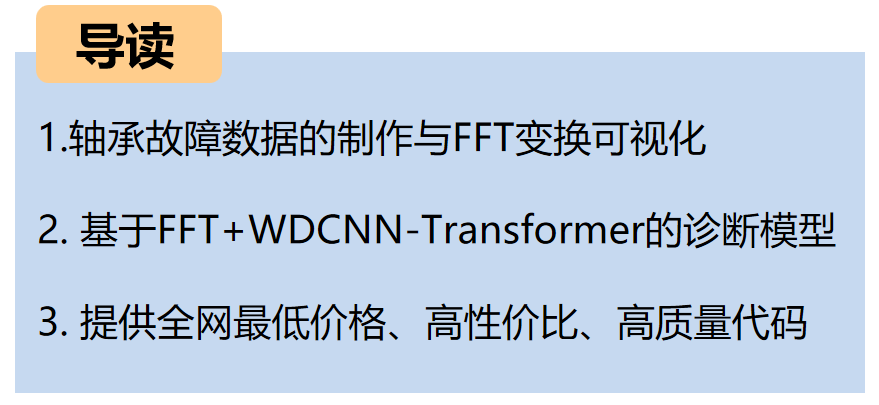
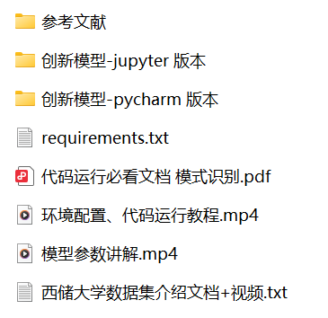
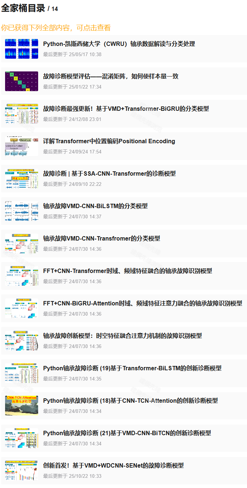
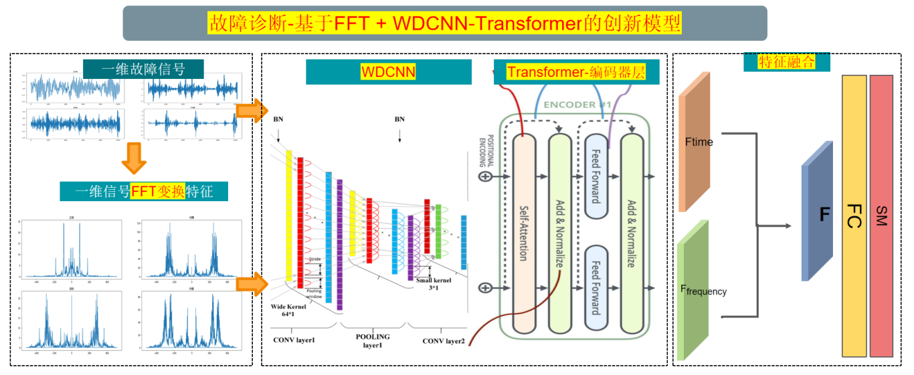

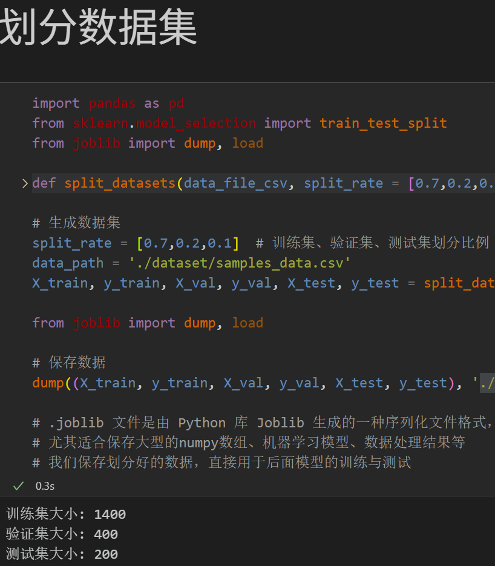
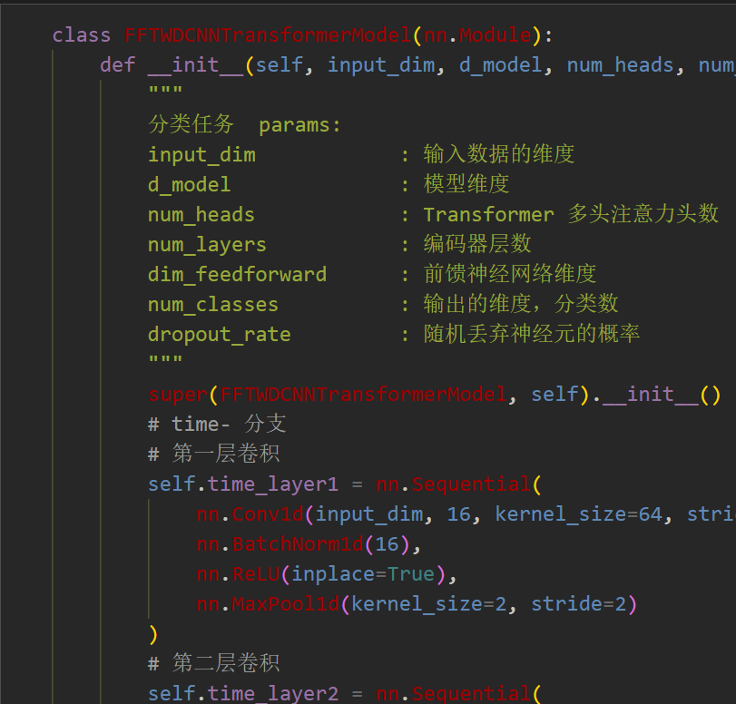
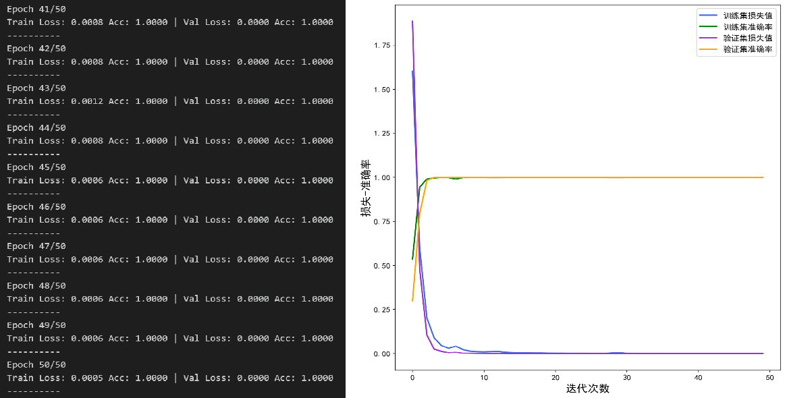
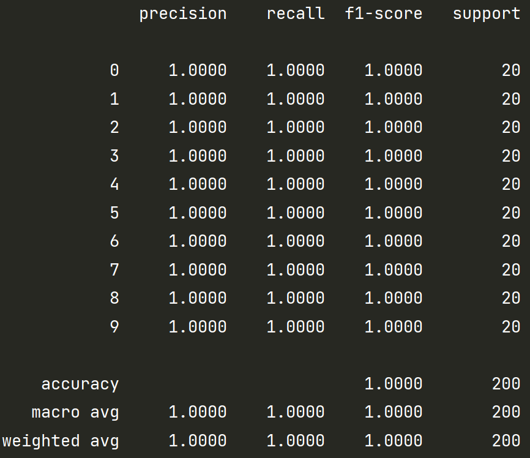
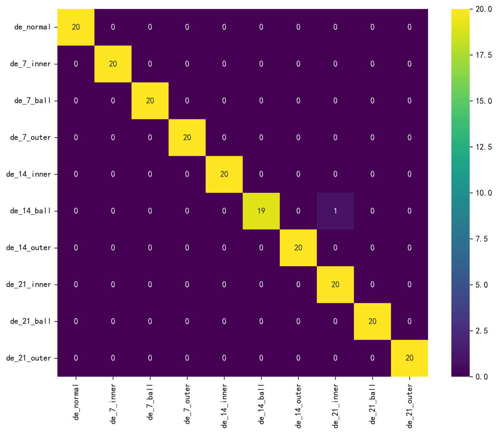
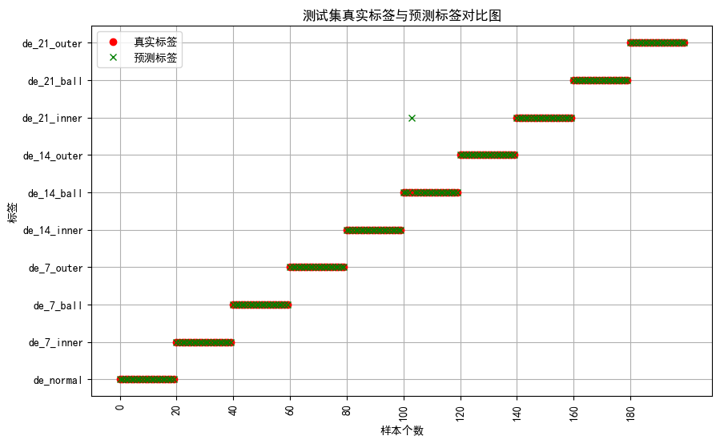
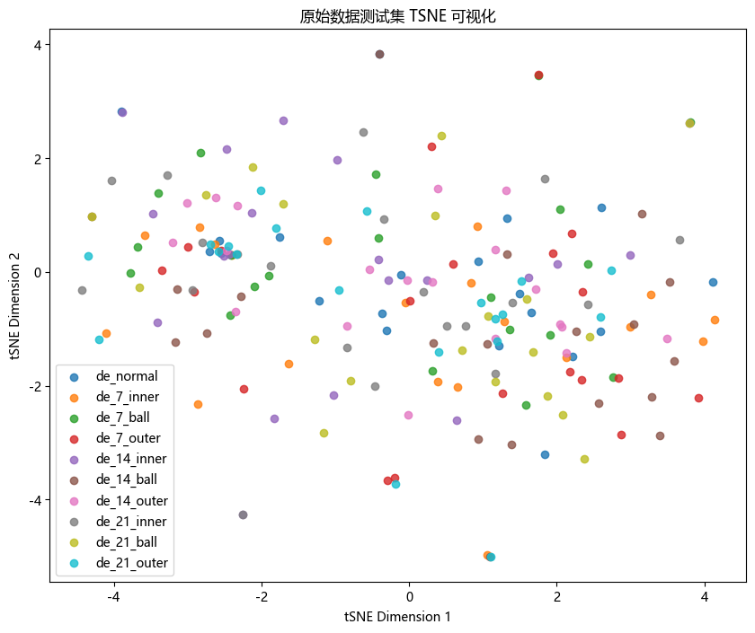
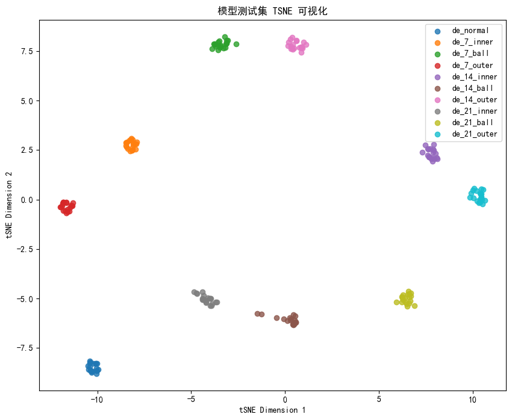

<!-- PAYMENT_BLOCK -->

## Get this dataset

- Payment link (Stripe): [Buy now](https://buy.stripe.com/3cs8yP7sY87d0vu9AB)
- Payment QR code: 

<!-- /PAYMENT_BLOCK -->
